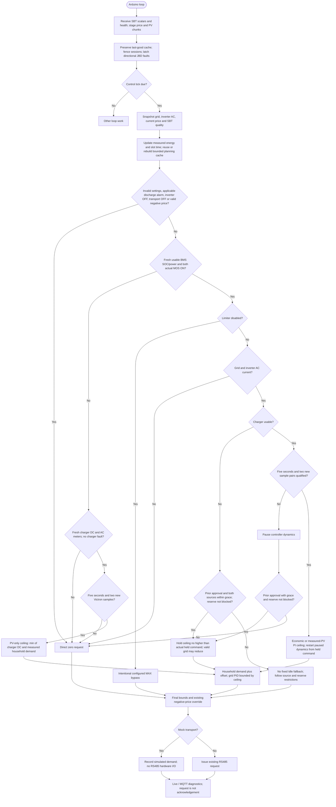

---
puppeteer:
  landscape: true
  format: A4
  printBackground: true
---

# SIL - Implemented integration

Updated 2026-10-20. [Active plan](../superpowers/plans/2026-10-20-sil-sbt-ha-integration.md) / [specification](2026-10-20-integration-spec.md). This describes source behavior, not completed plant acceptance.

`main.cpp::processRS485Tick`, `CurrentControl::update`, `FuturePrices::plan` and `sbt::Service::controlSnapshot` own these boundaries. A held or recovering regulated decision still passes through the grid PID; a zero recovery decision is direct. The selected timeout is 1..9999 seconds, default 180. Collector/control acquisition freshness remains bounded separately at 30 seconds. The PV-only branch requires independently qualified Victron data and caps the result by corrected household demand and measured charger power. Missing PV/meters or a known charger fault requests zero. A sole software MOS-lock discharge bit is exempt only in PV-only mode; other latched discharge faults remain stops. `Idle Output (W)` is retained as a setting but does not select an output.

Missing telemetry creates no alarm and never clears a known restriction. A received JBD discharge restriction bypasses normal recovery qualification at the next control evaluation. Charge-only restrictions remain direction-specific diagnostics; this increment adds no MOS actuator. Inverter loss-of-command behavior and actual plant response remain separate hardware qualifications.

`Output Correction Offset (W)` biases household demand before the automatic PID or manual mode calculation, not the final command or the battery plan. A 600 W household demand with -100 W offset is limited to 500 W; a lower 200 W battery ceiling remains 200 W. Direct stops, source and PV limits, MAX, and the separately qualified MIN retain their precedence.
