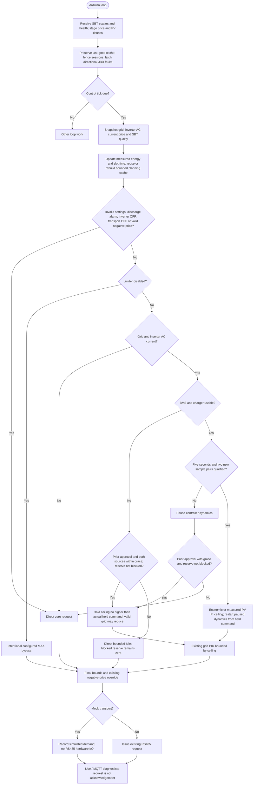

---
puppeteer:
  landscape: true
  format: A4
  printBackground: true
---

# SIL - Implemented integration

Updated 2026-10-20. [Active plan](../superpowers/plans/2026-10-20-sil-sbt-ha-integration.md) / [specification](2026-10-20-integration-spec.md). This describes source behavior, not completed plant acceptance.

`main.cpp::processRS485Tick`, `CurrentControl::update`, `FuturePrices::plan` and `sbt::Service::controlSnapshot` own these boundaries. A held or recovering regulated decision still passes through the grid PID; a zero recovery decision is direct. The selected timeout is 1..9999 seconds, default 180. Collector/control acquisition freshness remains bounded separately at 30 seconds. Source loss no longer selects MAX; the intentional Limiter-OFF bypass remains distinct.

Missing telemetry creates no alarm and never clears a known restriction. A received JBD discharge restriction bypasses normal recovery qualification at the next control evaluation. Charge-only restrictions remain direction-specific diagnostics; this increment adds no MOS actuator. Inverter loss-of-command behavior and actual plant response remain separate hardware qualifications.
