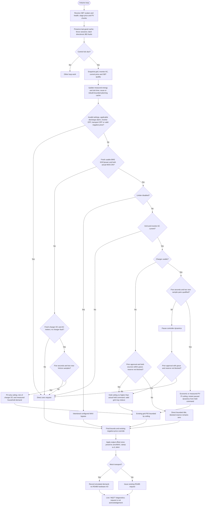

---
puppeteer:
  landscape: true
  format: A4
  printBackground: true
---

# SIL - Implemented integration

Updated 2026-10-20. [Active plan](../superpowers/plans/2026-10-20-sil-sbt-ha-integration.md) / [specification](2026-10-20-integration-spec.md). This describes source behavior, not completed plant acceptance.

`main.cpp::processRS485Tick`, `CurrentControl::update`, `FuturePrices::plan` and `sbt::Service::controlSnapshot` own these boundaries. A held or recovering regulated decision still passes through the grid PID; a zero recovery decision is direct. The selected timeout is 1..9999 seconds, default 180. Collector/control acquisition freshness remains bounded separately at 30 seconds. Missing or invalid essential BMS data, or either actual MOS permission OFF/unknown, selects the PV-only branch before the intentional Limiter-OFF bypass. This branch ignores battery-power PI/forecast discharge permission, requires independent Victron qualification, and caps the PID result by measured household demand and charger DC power before the final output correction. Missing PV/meters or a known charger fault requests zero. A sole software MOS-lock discharge bit is exempt only in PV-only mode; other latched discharge faults remain stops. Missing charger data with valid BMS and both MOS ON retains the bounded grace/Idle policy.

Missing telemetry creates no alarm and never clears a known restriction. A received JBD discharge restriction bypasses normal recovery qualification at the next control evaluation. Charge-only restrictions remain direction-specific diagnostics; this increment adds no MOS actuator. Inverter loss-of-command behavior and actual plant response remain separate hardware qualifications.

`Output Correction Offset (W)` retains the persisted `LimiterCorrW` key and applies exactly once to the complete calculated command, immediately before transmission. It is no longer part of the PID input. An uncorrected zero remains zero and configured MAX remains MAX; every intermediate result is offset and then clamped to 0..MAX before conversion to the wire type. Thus 0 + 50 = 0 W, 1 + 50 = 51 W, 1 - 50 = 0 W, and 200 + 50 = 250 W. This intentional final bias may exceed the pre-correction PV or household ceiling; other battery and forecast efficiency models are unchanged.
