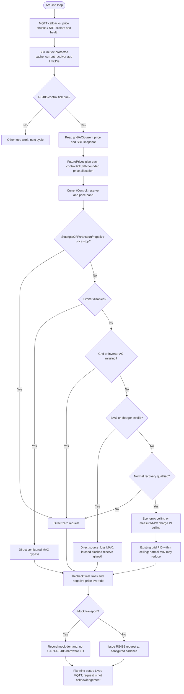
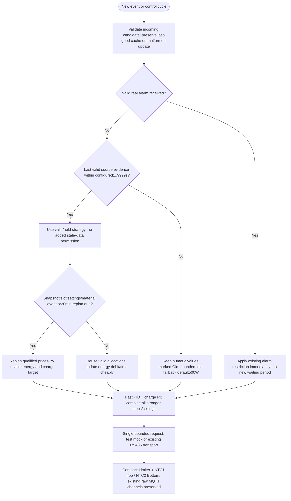

---
puppeteer:
  landscape: true
  format: A4
  printBackground: true
---

# SIL - Actual integration and approved next increment

Updated2026-10-20. [Active plan](../superpowers/plans/2026-10-20-sil-sbt-ha-integration.md) and [specification](2026-10-20-integration-spec.md) are authoritative for the new increment. Diagrams below deliberately distinguish current source from target behavior; no firmware was changed by this documentation update.

## Current source: implemented path

Source anchors: main.cpp processRS485Tick/FuturePrices.plan; CurrentControl.h update. Full ProtectionCoordinator and several PreparedControl boundaries remain stubs; SIL MOS commands remain locked. Do not interpret the older protection diagrams as already wired into this path.

## Approved next integration: target, not yet implemented

Missing telemetry never creates an alarm. A known restriction is not cleared by silence. Plan validity and measurement tolerance are separate clocks. No second alarm delay or unapproved MOS actuator is introduced. Inverter command loss may leave the last setpoint active: independent hardware behavior remains unqualified.