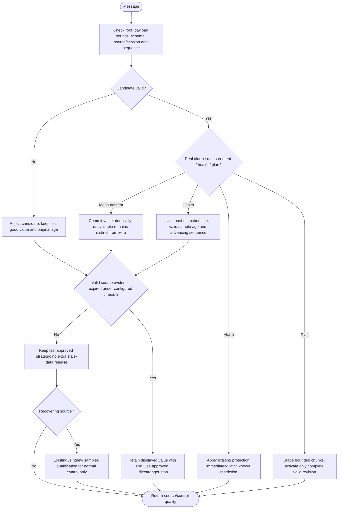

---
puppeteer:
  landscape: true
  format: A4
  printBackground: true
---

# SIL - Telemetry validity, held values and immediate alarms

Target requirements: [active plan](../superpowers/plans/2026-10-20-sil-sbt-ha-integration.md), [specification](2026-10-20-integration-spec.md). Current source still has15s receiver/30s collector thresholds and cache-clearing behavior. The following is the approved replacement, not passed runtime evidence.

Setting `SBT Data Timeout (s)` is1..9999, default180; no second timeout or doubled alarm wait. Source-health arrives about5s, unchanged scalar refresh60s: scalar receipt age alone must not falsely mark a healthy source Old. Retained health or duplicate sequence is not a new sample. Source restart needs identity fencing and requalification; preserve old values only as historical display until safe continuity is established.

Producer stale acquisition status is diagnostic and must not clear consumer cache before its deadline. This does not extend MOS command readiness or real device protection sampling. Authentic alarm data remains immediate; absent data does not imply an alarm.

The observed UINT32_MAX age arises from old loop time minus a newly received timestamp. Copy the sample before sampling current time; retain modulo arithmetic across real millis rollover. Do not hide true old data with an absolute value.