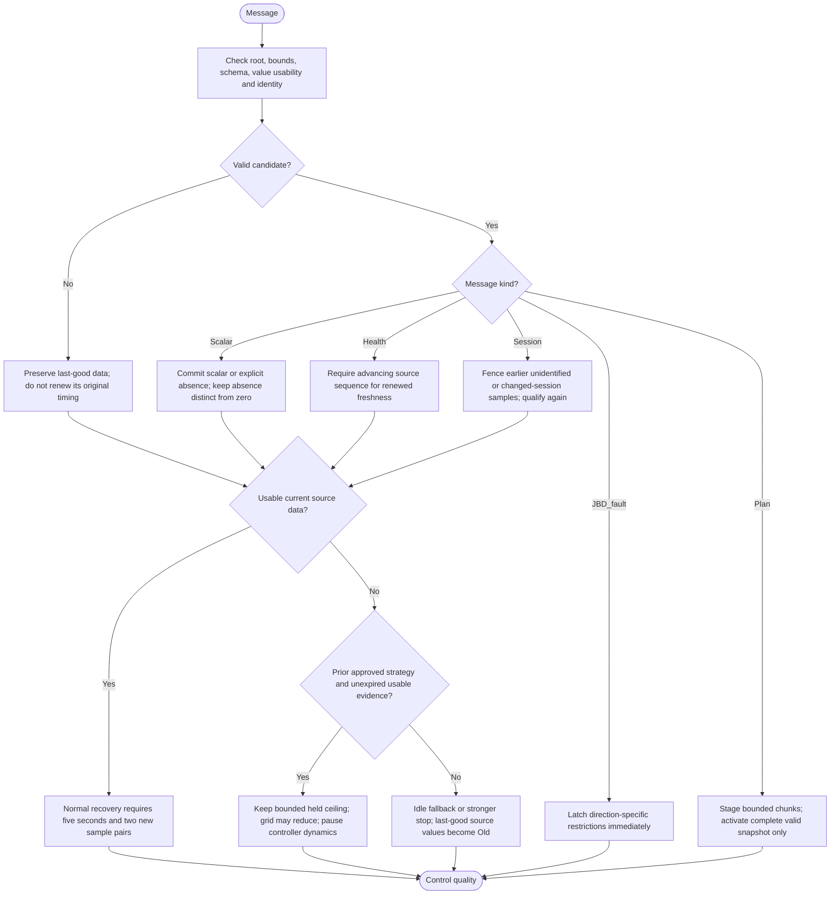

---
puppeteer:
  landscape: true
  format: A4
  printBackground: true
---

# SIL - Implemented telemetry qualification

[Active plan](../superpowers/plans/2026-10-20-sil-sbt-ha-integration.md) / [specification](2026-10-20-integration-spec.md).

## Three separate clocks

- **Acquisition/control freshness:** SBT's source freshness is 30 seconds. SIL also requires online/available source evidence, an advancing sequence and usable essential scalars. A longer display deadline does not extend this acquisition window.
- **Consumer grace and display:** `sbtAgeS` selects 1..9999 seconds, default 180, measured from original valid source evidence including its reported sample age. Only usable essential evidence renews held-control permission. Invalid settings normalize to 180. After expiry, historical numeric source values remain visible with `Old`; startup data remains unavailable. Explicitly absent positioned sensors are not substituted with another sensor.
- **Plans:** price/PV coverage and generation/expiry are independent UTC properties. Publisher silence does not grant telemetry freshness or arbitrarily expire a still-covered schedule.

Health normally updates about every five seconds; unchanged valid scalars receive a full refresh every 60 seconds. Advancing source health can therefore keep unchanged scalar values current. Duplicate or older health does not restart the clock. Local disconnect fences control eligibility while retaining bounded historical display/hold information. The first observed collector identity also fences previously unidentified samples; a changed identity permits fresh sequence qualification instead of blindly accepting a rollback. Root changes discard that root's scalar cache while preserving known alarm restrictions.

Malformed or stale health does not erase the last-good scalar cache. Per-field absence, unusable values, acquisition failure, and a received alarm have different meanings. A fresh explicit fault-clear value may clear the applicable JBD latch; silence, malformed data and reconnect do not. Charge-only faults do not automatically forbid discharge. SIL MOS commands remain locked, and no full protection coordinator is implied.

SBT now copies each corresponding source snapshot after BLE dispatch and captures `millis()` afterward for health generation. This removes the old loop-time T versus sample-time T+1 subtraction defect. Unsigned subtraction still handles real uint32 rollover; no absolute-value or blanket age clamp hides truly stale samples. SIL likewise obtains its control-snapshot time under the receiver mutex.
