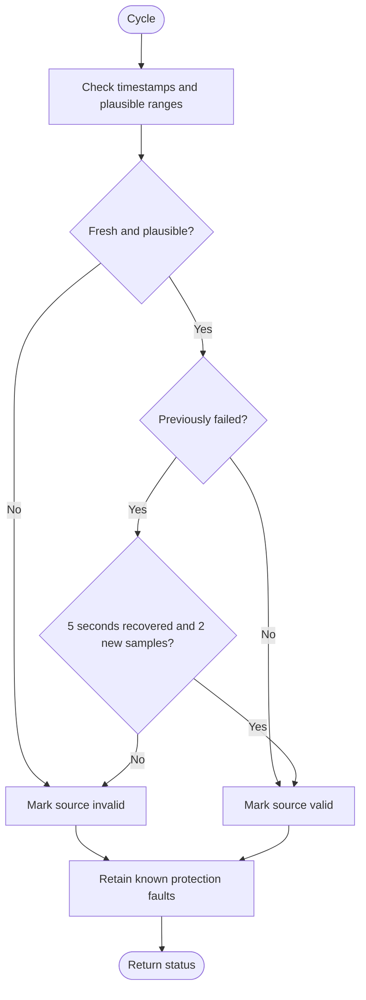

---
puppeteer:
  landscape: true
  format: "A4"
  printBackground: true
---

# SIL - Validate measurement freshness and plausibility

Current baseline: [Round 5 decisions and initial constants](round-5-decisions-and-defaults.md). Round 5 takes precedence over older proposals; no device settings have been changed.

Status: 2026-10-17, Round 5. Owner-approved first design; not implemented or hardware-qualified.

**Inputs and outputs:** Timestamped, sourced measurements -> per-source validity, retained protection faults, and recovery status.

**Shapes:** Rectangle = action; double-sided rectangle = subprogram; diamond = decision; rounded shape = start/end.

Freshness limits initially use programmed defaults; optional configurability may be added only if ESP resources permit. The five-second recovery period and two new samples remain fixed recovery behavior. Three expected sample intervals was only a proposal and is not validated. Repeated old MQTT values are not new samples; invalid is not zero. Source-specific freshness limits and ranges remain to be qualified. Future settings may be considered if ESP resources permit.
