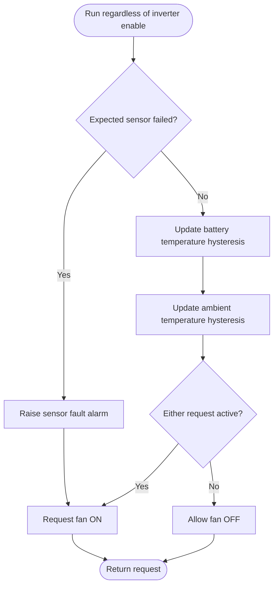

---
puppeteer:
  landscape: true
  format: "A4"
  printBackground: true
---

# SIL - Determine fan demand from battery and ambient temperatures

> Current execution: [single active integration plan](../superpowers/plans/2026-10-20-sil-sbt-ha-integration.md). This file is a preserved design reference; it does not prove full runtime integration. The [October20 specification](2026-10-20-integration-spec.md) supersedes conflicting timeout/fallback/UI defaults. Do not delay received alarms or infer an alarm from missing data.

Current baseline: [Round 5 decisions and initial constants](round-5-decisions-and-defaults.md). Round 5 takes precedence over older proposals; no device settings have been changed.

Status: 2026-10-17, Round 5. Owner-approved first design; not implemented or hardware-qualified.

**Inputs and outputs:** Battery and ambient temperature, sensor validity, and internal settings -> fan request.

**Shapes:** Rectangle = action; double-sided rectangle = subprogram; diamond = decision; rounded shape = start/end.

Provisional thresholds are battery 40 C and ambient 35 C, each with 3 K hysteresis; these are not qualified battery protection limits. Reuse the ConfigManager analog alarm callbacks: a sibling checkout exposes `AlarmSeverity::{Alarm,Warning}`, `addAnalogAlarm`, `addAnalogWarning`, `onAlarmCome`, `onAlarmGone`, `onAlarmStay`, `onStateChanged`, and `setUpdateInterval`. Confirm that these APIs are present in the pinned SIL dependency and verify alarm hysteresis semantics before implementation. If inverter OFF or a negative-price stop prevents charge/heat mitigation, raise a Home Assistant app alarm and turn the fan ON. This alarm and fan response do not prove that charging has physically stopped; no charger control is assumed. Normal temperature-driven fan operation is not itself a fault and must not generate an alarm every cycle. Operating modes are Auto and On, with a separate explicit maintenance OFF concept. Initial priority choice: a protection or expected-sensor-failure demand overrides a normal or maintenance fan-OFF request; expose the override reason. This does not change the separately specified manual MOS priority.
