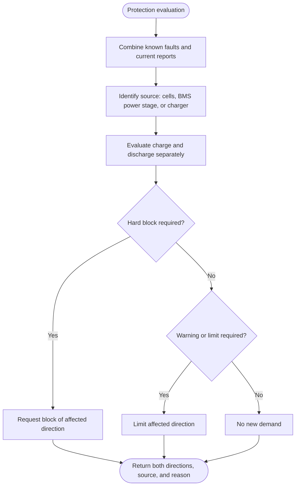

---
puppeteer:
  landscape: true
  format: "A4"
  printBackground: true
---

# SIL - Evaluate directional battery protection

Current baseline: [Round 5 decisions and initial constants](round-5-decisions-and-defaults.md). Round 5 takes precedence over older proposals; no device settings have been changed.

Status: 2026-10-17, Round 5. Owner-approved first design; not implemented or hardware-qualified.

**Inputs and outputs:** Valid BMS and Victron reports, temperature source, cell values, and current direction -> separate charge and discharge protection demands.

**Shapes:** Rectangle = action; double-sided rectangle = subprogram; diamond = decision; rounded shape = start/end.

Protection is evaluated at the top of the control flow and applies even when the inverter is disabled. It outranks economics and the Limiter OFF bypass. Limiter OFF bypasses economic control only; it does not bypass protection or measurement fallback. Existing protection remains latched through telemetry loss. Clearing requires valid recovery evidence and satisfied release conditions. Reuse CM warning and main-alarm callbacks for the analog signals, as directed by the owner. The sibling AlarmManager API is observed, but the dependency used by SIL and its hysteresis and invalid-sample behavior still require verification. Callbacks update protection state; physical command arbitration remains separate. Charge/discharge thresholds and hysteresis require qualification; no new thresholds are inferred.
