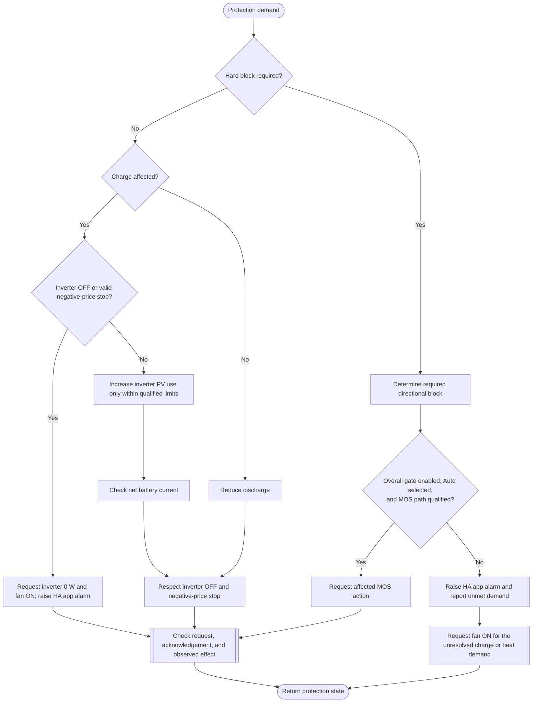

---
puppeteer:
  landscape: true
  format: "A4"
  printBackground: true
---

# SIL - Limit or block charging and discharging

> Current execution: [single active integration plan](../superpowers/plans/2026-10-20-sil-sbt-ha-integration.md). This file is a preserved design reference; it does not prove full runtime integration. The [October20 specification](2026-10-20-integration-spec.md) supersedes conflicting timeout/fallback/UI defaults. Do not delay received alarms or infer an alarm from missing data.

Current baseline: [Round 5 decisions and initial constants](round-5-decisions-and-defaults.md). Round 5 takes precedence over older proposals; no device settings have been changed.

Status: 2026-10-17, Round 5. Owner-approved first design; not implemented or hardware-qualified.

**Inputs and outputs:** Directional protection demands, permissions, and measurements -> bounded request, permitted MOS action, and result.

**Shapes:** Rectangle = action; double-sided rectangle = subprogram; diamond = decision; rounded shape = start/end.

Automatic MOS operation is limited to fault handling, not reserve or economics. Keep the existing overall BmsControl write gate and add a separate Hand/Auto selector (proposed compact key mosMan). In Hand, SIL publishes the protective request and alarms but does not move MOS; manual operation wins. In Auto, SIL may handle qualified fault requests. Enforce origin and ownership at SBT admission and transmission; HA is not the sole interlock. Returning to Auto triggers fresh evaluation, never replay. Do not equate no SIL request with an ON command.

Automatic restoration only reverses a still-owned fault block after valid release evidence; a later manual command invalidates that ownership. Inverter 0 W does not prove that PV charging has stopped. No PV-only path is assumed with discharge MOS off. BMS hardware protection remains independent.

Alarm plus fan is the accepted escalation when inverter OFF or a negative-price stop prevents charge/heat mitigation. The missing-grid exception allows charge mitigation only with fresh BMS evidence of reduced charging and no discharge restriction. A hard discharge restriction also requests inverter reduction if MOS action is denied or fails. Every path passes through final arbitration so simultaneous charge/discharge restrictions, manual ownership and explicit zero requirements cannot be bypassed. See [current decisions and defaults](round-5-decisions-and-defaults.md).
