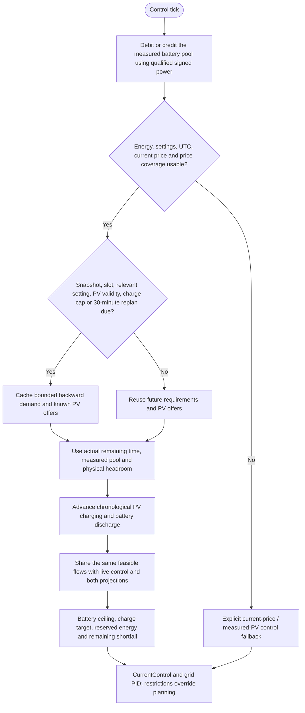

---
puppeteer:
  landscape: false
  format: A4
  printBackground: true
---

# SIL - Cached planning and fast regulation

[Active plan](../superpowers/plans/2026-10-20-sil-sbt-ha-integration.md) / [wire contract](mqtt-schedule-contract.md). `FuturePrices::plan` consumes independent validated price and PV snapshots; the planner does not command an actuator.

## Actual energy and forecast credit

The measured pool is initialized once from usable SOC above the reserve floor, full capacity and the existing nominal 51.38 V conversion. Subsequent calls integrate signed BMS power: charging is positive, discharge negative. Repeated calls with the same sample sequence debit/credit held power; new sequences update the endpoint. Fresh SOC caps the same pool. Missing energy inputs or excessive gaps suspend integration without refilling the pool from SOC or crediting unknown outage charging. Clearing a schedule does not reset this pool.

Available stored energy receives the discharge conversion once. Forecast PV remains a separate DC offer and never increases the measured pool. Configured MAX (900 W in the owner configuration) bounds AC output. Known PV may supply that output directly or be retained for profitable later discharge; it no longer has to exceed MAX / dischargeEfficiency before any charging is possible. Qualified current MPPT power anchors the first remaining interval, and accepted forecasts supply later intervals. Charging is bounded by available PV, physical headroom and the qualified installed charge limit (35 A times fresh charger battery voltage for the accepted MPPT 150/35). A zero charge allowance prevents storage while measured direct PV remains usable. Calibration is applied once by PvForecast.

A cached backward marginal-demand calculation prioritizes higher prices, with earlier intervals breaking equal-price ties. Existing energy is protected only for materially better future prices (the existing 3-cent gate). Retaining PV additionally requires the existing roundtrip, wear and minimum-benefit test. Each PV offer can reduce only demand at or after its actual arrival. Demand beyond physical usable storage is pruned by price priority. An initial Reserve OFF debt is a separate, non-dischargeable prerequisite of a real future battery target; it consumes charge energy and cannot disappear through the usable-capacity cap. Abundant later cheap PV can cover both that prerequisite and the target without unnecessary earlier expensive charging.

Since 5.4.8, every valid live call advances one private chronological energy ledger over the remaining horizon. It debits AC discharge, fills any initial Reserve OFF deficit before crediting usable energy, and books DC charging once within headroom and charge-power limits. A slot has one net battery direction. Unknown PV supplies no assumed energy, but later independently known sunlight remains usable. The actual controller price state, including Cheap hysteresis, anchors the first interval. Live battery allowance, live charge target, red discharge allowance and blue charging flows come from this same calculation; the diagnostic capture does not drive PID or an actuator.

The result is a conditional discharge upper bound, not a complete inverter command or guaranteed load. Actual reserve-ON hysteresis/latch state, source qualification, faults, capability, household demand, MIN, PID/ramp state and final correction retain their existing live authority. The complete projected future sum can exceed the current protected `reservedWh`/`allocWh` by including unreserved energy or PV stored later; it must instead obey chronological energy bounds.

## Cache and timing

The price receiver can hold 288 quarter-hour slots; planning uses at most 144 slots / 36 hours. Slot length is 900 seconds, with only the actual remaining duration used in the first interval. Cached backward work is bounded by 144 squared rank visits; each valid control tick performs a linear forward calculation, independently of whether a diagnostic capture is due. Rebuild conditions include price/PV revisions, UTC slot, relevant limits and reserve debt, or the 30-minute replan maximum. All planner workspaces are fixed arrays with scalar locals; there is no per-step heap allocation or large planner-object stack copy. The separate measured-energy ledger, source sequences and polling-retention timestamps are unchanged.

Schedules survive publisher absence while their actual UTC coverage remains usable. A price-plan clock rollback greater than five seconds invalidates that schedule. Missing current price or insufficient price coverage returns an explicit fallback, not a fabricated forecast. Negative price, OFF, blocked reserve and applicable alarm restrictions override economic release. Current-price fallback is not a claim that the older complete three-hour-budget reference is implemented.

## Home Assistant boundary

The Shed producer requests raw provider END timestamps, validates each previous-to-end energy interval, and assigns it to its actual containing UTC hour before producing four quarter-hour powers. Integer hourly Wh is conserved and fractional totals are quantized to the nearest 0.25 Wh. HA's built-in hour-floor aggregation is deliberately bypassed; see the [provider timing evidence](../home-assistant/shed-migration.md). Quality remains `hourly_disaggregated`; absent intervals, including absent night entries, remain missing rather than invented zero generation.

Calibration uses original forecasts frozen before the day starts, with hourly totals checked against the independent native day total. Actual daily yield must have complete, reset-free, outage-free and non-curtailed qualification, including applicable current-limit evidence. At least 14 eligible completed days within a 30-day lookback are required; until then the factor is neutral 1.0 and quality is `uncalibrated`. The qualified median ratio is bounded to 0.5..1.2. EPEX future-price provenance remains provider-unknown; distant values are not asserted to be confirmed market prices. Physical daily energy reconciliation and plant acceptance remain separate from parser/planner behavior.

## Display continuity during source gaps

Published display snapshots are separate from live control inputs. Since 5.4.9, accepted current-price or forecast-content updates request a new capture while a temporarily unqualified source can retain the previous diagnostic snapshot. The original generation time and arrays remain unchanged, with the same 180-second maximum age. Source recovery requests fresh capture promptly. Actual settings, configured source/output topics, validity/coverage failures and known physical faults still invalidate held diagnostics. The current controller never reads a held display snapshot.
