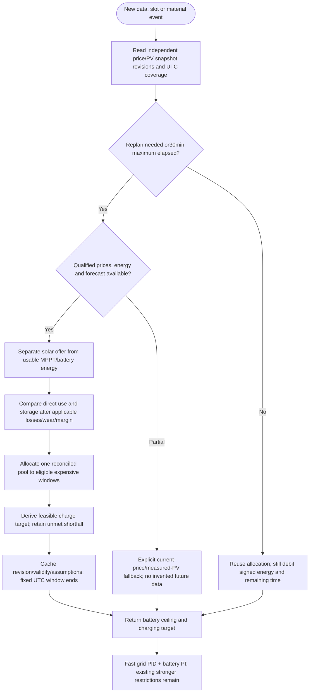

---
puppeteer:
  landscape: false
  format: A4
  printBackground: true
---

# SIL - Slow planning connected to fast regulation

[Active plan](../superpowers/plans/2026-10-20-sil-sbt-ha-integration.md) / [specification](2026-10-20-integration-spec.md).

Current source already uses a bounded price schedule and nominal battery pool in FuturePrices, recomputing/sorting each control tick. PV forecast ingestion, frozen-snapshot calibration and event-cached planning below are target changes. Existing current-price fallback is not the complete earlier three-hour budget implementation.

Slots900s, initial horizon36h and planning load650W are planning assumptions, not a15-minute control loop or forced output. Valid schedules survive publisher absence until expiry/coverage end; never treat a valid price plan as fresh BMS data. Missing intervals remain missing, hourly energy disaggregation conserves energy and declares lower source resolution. Use explicit source quality; EPEX distant values may be estimates.

Already-stored energy incurs discharge conversion once, not a second acquisition roundtrip. New storage compares forgone current value with future delivered value including roundtrip/wear/required margin. Fresh SOC reconciles the same pool; never add carried allocations to fresh capacity. Negative-price/OFF/reserve and immediate alarms override economics.