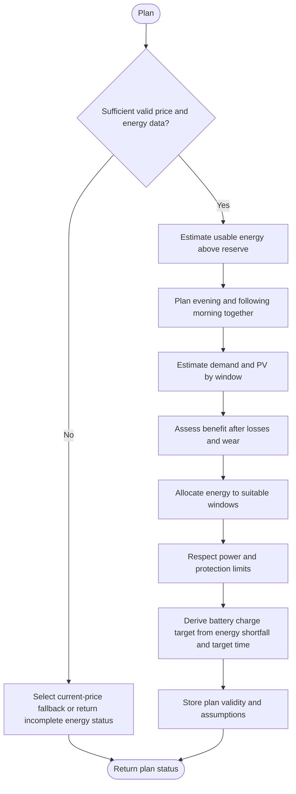

---
puppeteer:
  landscape: false
  format: "A4"
  printBackground: true
---

# SIL - Plan energy across evening and morning

Current baseline: [Round 5 decisions and initial constants](round-5-decisions-and-defaults.md). Round 5 takes precedence over older proposals; no device settings have been changed.

Status: 2026-10-17, Round 5. Owner-approved first design; not implemented or hardware-qualified.

**Inputs and outputs:** Prices, SOC, reserve, expected load, and available PV forecast -> energy allocations by time window.

**Shapes:** Rectangle = action; double-sided rectangle = subprogram; diamond = decision; rounded shape = start/end.

Use the current [Round 5 baseline](round-5-decisions-and-defaults.md). The price strategy produces a ceiling for the existing grid PID, not a forced inverter output. Start with comfort EUR 0.25/kWh and db EUR 0.06/kWh; derive switching hysteresis as db / 3 without another setting. With valid current price but missing future prices, cheap/comfort preserves battery, expensive allocates energy over an anchored three-hour window, and very expensive (comfort + 2*db) permits the otherwise allowed PID maximum. Negative-price zero, reserve and directional protection remain effective.

The owner selected two adjustable reserve thresholds: discharge OFF at 2% and ON at 10%; retain the previous permission between thresholds. No separate reserve-hysteresis setting is needed. This is not BMS cell protection or long-term storage SOC. Planning load remains 650 W; the 36-hour look-ahead does not invent unavailable future prices or PV. Replan every 30 minutes plus events and apply actual 15-minute price boundaries on time. An invalid energy estimate returns incomplete status; it must not reach PID with an uninitialized cap. Missing current price uses the documented battery-preserving initial fallback, subject to the measurement policies.

Use separate code constants for discharge efficiency, round-trip efficiency, wear, and minimum advantage, with optional settings later if resources permit. Replanning replaces energy allocations in one common ledger; it must not add old carried energy to fresh SOC energy. The earlier separate 0.35 hold threshold is not an additional active setting; later-window holding and in-window release must remain distinct.

See the accepted [charge-target and dynamic PV-ceiling addendum](10-charge-target-and-pv-ceiling.md) for storage control, shared actuator arbitration, ramp exceptions, and the accepted transient-discharge limitation.
