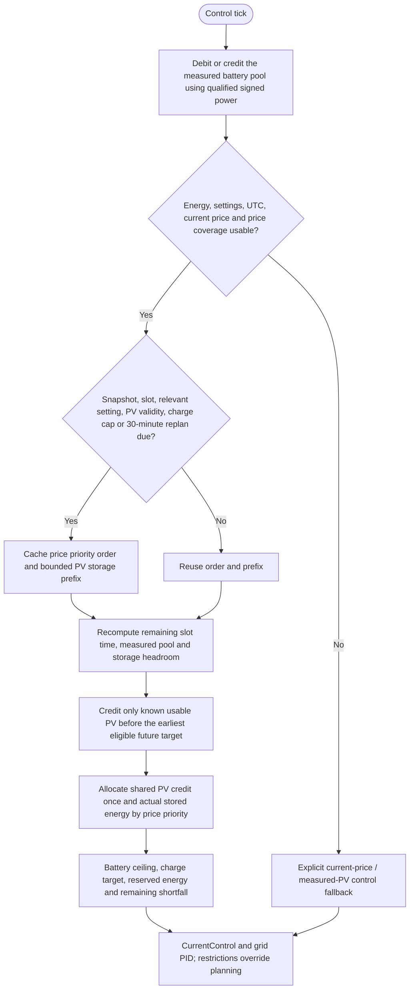

---
puppeteer:
  landscape: false
  format: A4
  printBackground: true
---

# SIL - Cached planning and fast regulation

[Active plan](../superpowers/plans/2026-10-20-sil-sbt-ha-integration.md) / [wire contract](mqtt-schedule-contract.md). `FuturePrices::plan` consumes independent validated price and PV snapshots; the planner does not command an actuator.

## Actual energy and forecast credit

The measured pool is initialized once from usable SOC above the reserve floor, full capacity and the existing nominal 51.38 V conversion. Subsequent calls integrate signed BMS power: charging is positive, discharge negative. Repeated calls with the same sample sequence debit/credit held power; new sequences update the endpoint. Fresh SOC caps the same pool. Missing energy inputs or excessive gaps suspend integration without refilling the pool from SOC or crediting unknown outage charging. Clearing a schedule does not reset this pool.

Available stored energy receives the discharge conversion once. Forecast PV is a separate offer, never added to the measured pool. The planner bounds potential storage by the qualified MPPT charge-power cap, the 650 W planning load and battery headroom. The current installed planning cap is 35 A times fresh measured charger battery voltage, based on the accepted MPPT 150/35 hardware maximum and the owner's confirmation of no additional configured current limit. An unknown/zero cap grants no PV storage credit; this does not program a device limit.

Only continuous known PV **before the earliest eligible reserved future slot** can reduce future stored-energy demand. The resulting single credit is allocated once across eligible future loads; later sunshine is deliberately unused in this conservative increment. Current-slot discharge allocation always comes from actual available energy. Offered PV, assigned usable PV, reserved stored energy and unresolved shortfall are reported separately. Forecast calibration is applied once by `PvForecast::wattsAt`.

## Cache and timing

The price receiver can hold 288 quarter-hour slots; planning uses at most 144 slots / 36 hours. Slot length is 900 seconds, not the control period. The cached price order uses 288 bytes and the PV prefix uses 580 bytes. Rebuild conditions include price/PV revisions, UTC slot, PV validity, effective whole-watt charge cap, current price/band, price factor, maximum output, comfort/deadband and reserve settings, or the 30-minute replan maximum. Every control call still performs bounded O(144) allocation arithmetic using current remaining time and energy; expensive sorting/prefix construction is cached.

Schedules survive publisher absence while their actual UTC coverage remains usable. A price-plan clock rollback greater than five seconds invalidates that schedule. Missing current price or insufficient price coverage returns an explicit fallback, not a fabricated forecast. Negative price, OFF, blocked reserve and applicable alarm restrictions override economic release. Current-price fallback is not a claim that the older complete three-hour-budget reference is implemented.

## Home Assistant boundary

The Shed producer requests raw provider END timestamps, validates each previous-to-end energy interval, and assigns it to its actual containing UTC hour before producing four quarter-hour powers. Integer hourly Wh is conserved and fractional totals are quantized to the nearest 0.25 Wh. HA's built-in hour-floor aggregation is deliberately bypassed; see the [provider timing evidence](../home-assistant/shed-migration.md). Quality remains `hourly_disaggregated`; absent intervals, including absent night entries, remain missing rather than invented zero generation.

Calibration uses original forecasts frozen before the day starts, with hourly totals checked against the independent native day total. Actual daily yield must have complete, reset-free, outage-free and non-curtailed qualification, including applicable current-limit evidence. At least 14 eligible completed days within a 30-day lookback are required; until then the factor is neutral 1.0 and quality is `uncalibrated`. The qualified median ratio is bounded to 0.5..1.2. EPEX future-price provenance remains provider-unknown; distant values are not asserted to be confirmed market prices. Physical daily energy reconciliation and plant acceptance remain separate from parser/planner behavior.
