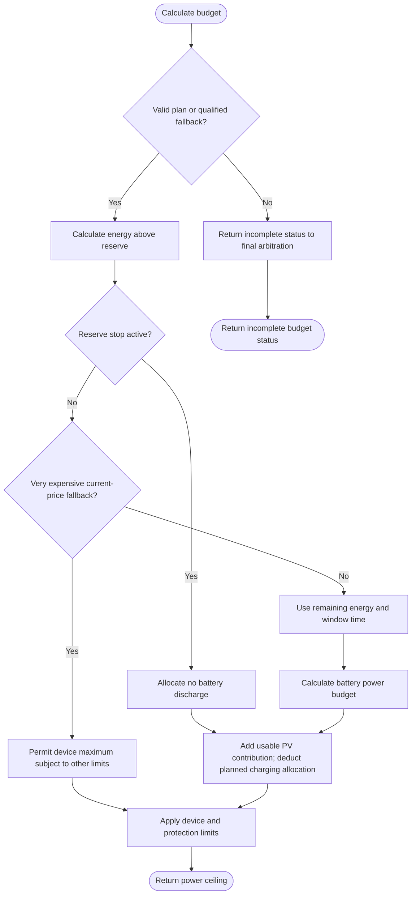

---
puppeteer:
  landscape: true
  format: "A4"
  printBackground: true
---

# SIL - Calculate the current energy budget and power ceiling

Current baseline: [Round 5 decisions and initial constants](round-5-decisions-and-defaults.md). Round 5 takes precedence over older proposals; no device settings have been changed.

Status: 2026-10-17, Round 5. Owner-approved first design; not implemented or hardware-qualified.

**Inputs and outputs:** Valid plan, remaining allocated energy, window time budget, and current PV -> current AC power ceiling.

**Shapes:** Rectangle = action; double-sided rectangle = subprogram; diamond = decision; rounded shape = start/end.

Use the current [Round 5 baseline](round-5-decisions-and-defaults.md). The owner-selected reserve uses two adjustable thresholds: discharge OFF at 2%, ON at 10%. Retain permission between them; this is an eight-percentage-point hysteresis at the defaults. Price classification changes the PID ceiling, never overrides reserve or hard protection, and does not force output or export.

For a supported window, AC battery budget is allocated remaining AC kWh times 1000 divided by remaining hours. Avoid division by zero. The expensive-price fallback uses an anchored three-hour window; very expensive price lifts that time-budget cap to the otherwise permitted device ceiling. Replanning replaces allocations and reconciles the same energy pool against SOC and measured battery use. Missing price-plan data selects the documented fallback; missing energy data returns incomplete status rather than an unlimited cap.

Use fresh, time-aligned Victron charger DC output and signed BMS power (positive = charging), with a mandatory adjustable battery-power direction band (initial default 50 W). Use the derived Schmitt release thresholds in the current baseline; the neutral band must not erase measured energy from the energy ledger. Account for other DC loads and conversion losses, compare against inverter AC feedback, and never double-count discharge. Present delivered PV power does not reveal curtailed PV headroom. Positive MIN must not force reserve discharge with no PV. The exact power estimator and low-output inverter behavior remain commissioning checks; no PV-only path with a MOS open is assumed.

See the accepted [charge-target and dynamic PV-ceiling addendum](10-ladeziel-und-pv-begrenzung.md) for storage control, shared actuator arbitration, ramp exceptions, and the accepted transient-discharge limitation.
