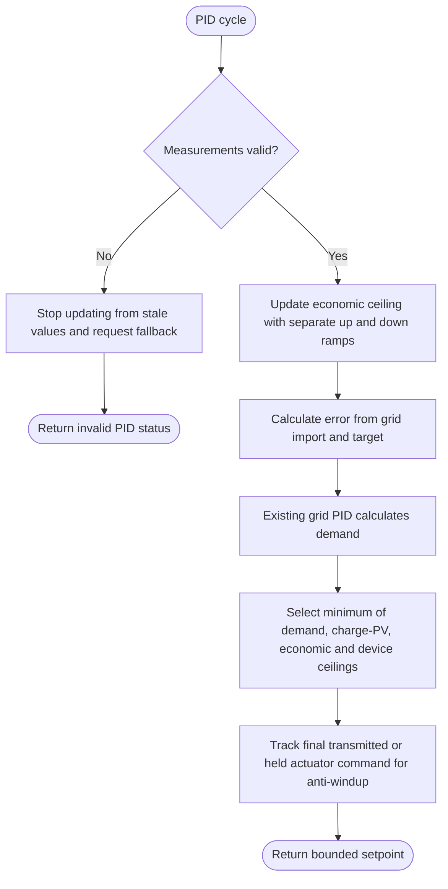

---
puppeteer:
  landscape: true
  format: "A4"
  printBackground: true
---

# SIL - Use grid PID to calculate power for household demand

> Current execution: [single active integration plan](../superpowers/plans/2026-10-20-sil-sbt-ha-integration.md). This file is a preserved design reference; it does not prove full runtime integration. The [October20 specification](2026-10-20-integration-spec.md) supersedes conflicting timeout/fallback/UI defaults. Do not delay received alarms or infer an alarm from missing data.

Current baseline: [Round 5 decisions and initial constants](round-5-decisions-and-defaults.md). Round 5 takes precedence over older proposals; no device settings have been changed.

Status: 2026-10-17, Round 5. Owner-approved first design; not implemented or hardware-qualified.

**Inputs and outputs:** Valid grid and inverter power, import target, and allowed limits -> requested inverter power.

**Shapes:** Rectangle = action; double-sided rectangle = subprogram; diamond = decision; rounded shape = start/end.

Reuse the existing grid PID. Ramp the normal economic ceiling using separate upward and downward constants, initially 50 W/s each; optionally expose both as settings if resources permit. Track the final transmitted/held actuator command for anti-windup in both the grid loop and the charge-loop correction, including output clipping and the RS485 publication interval. A sudden household-load drop or falling charge/PV ceiling may immediately reduce the request. Reserve, protection, inverter OFF and valid negative-price restrictions bypass the economic ramp. An economic target decrease alone uses the downward ramp. The 650 W value is a planning load, not a fixed PID target. Align signs and units with the existing SIL controller. Inverter OFF, MAX bypass, and protection mode require suitable integrator handling; smooth recovery remains to be checked.

See the accepted [charge-target and dynamic PV-ceiling addendum](10-charge-target-and-pv-ceiling.md) for storage control, shared actuator arbitration, ramp exceptions, and the accepted transient-discharge limitation.

## Legacy smoother removal

Owner decision: retain the existing proven grid PID; remove the old alternative smoother and its exclusive configuration/UI/state during implementation. Preserve shared utilities still used by PID or other features. The planned economic ceiling ramps remain required and are not the obsolete smoother. Verify unchanged PID operation and measure resource savings after removal.
