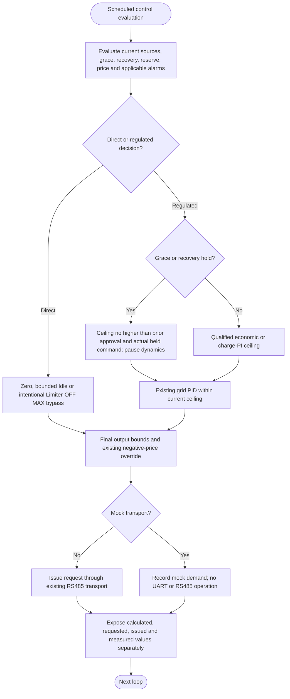

---
puppeteer:
  landscape: true
  format: A4
  printBackground: true
---

# SIL - One inverter request and truthful feedback

[Active plan](../superpowers/plans/2026-10-20-sil-sbt-ha-integration.md) / [specification](2026-10-20-integration-spec.md). The existing RS485/mock path is implemented. SIL MOS command previews remain locked; no complete automatic MOS protection coordinator or generic inverter acknowledgement layer was added.

`processRS485Tick` runs at the existing configured control/publication cadence. A direct Idle fallback is clamped to 0..effective MAX without enforcing configured MIN. Blocked reserve remains zero on source loss. Valid negative price, inverter OFF, transport OFF and applicable discharge alarms retain their stronger restrictions; normal missing grid/AC data stops regulated operation. Limiter-OFF bypass is intentionally distinct.

During an approved grace/recovery hold, fresh grid feedback may reduce demand, but stale source data cannot increase the permitted ceiling. Paused PI/economic dynamics restart from the actual held command after qualification, without integrating the outage or spending accumulated outage time as a ramp allowance. The normal ceiling-increase ramp is 50 W/s; restrictive PV/energy changes remain immediate at control evaluation.

Receiving a valid JBD fault updates the appropriate latch without waiting for the configurable data timeout or normal recovery qualification. Applying an inverter restriction still follows the actual control/transport execution path; this is not a promise of zero transport latency. Charge-only faults remain direction-specific, and no automatic MOS command or retry is added.

An issued request is not inverter acknowledgement or guaranteed physical zero. If SIL fails, the actuator may retain its last setpoint. Device loss-of-command behavior, real inverter response, BLE behavior and closed-loop plant performance require their own evidence. Test-board mock/no-data acceptance does not establish those properties or authorize production uploads.
