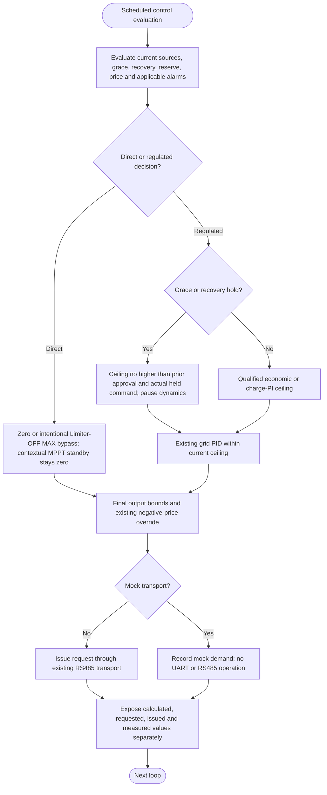

---
puppeteer:
  landscape: true
  format: A4
  printBackground: true
---

# SIL - One inverter request and truthful feedback

[Active plan](../superpowers/plans/2026-10-20-sil-sbt-ha-integration.md) / [specification](2026-10-20-integration-spec.md). The existing RS485/mock path is implemented. SIL MOS command previews remain locked; no complete automatic MOS protection coordinator or generic inverter acknowledgement layer was added.

`processRS485Tick` runs at the existing configured control/publication cadence. Missing BMS data or unavailable battery capabilities use the regulated PV-only path when fresh MPPT and AC-meter measurements permit it: the PID result is capped by both charger DC and household demand, including configured MIN, before final output correction. Limiter-OFF cannot route that path to MAX. Conversely, fresh healthy BMS data keep battery price planning active when MPPT telemetry is missing; advancing BMS samples qualify independently, unknown MPPT power adds no direct PV, and the previous fixed Idle fallback no longer substitutes for the calculated battery ceiling. A fresh healthy BMS reporting actual discharge MOS OFF plus an unavailable MPPT enters contextual standby and holds zero, including with Limiter OFF. The actual MOS state is not rewritten. Blocked reserve, negative price, inverter/transport OFF, missing meters and applicable alarms retain their stronger restrictions. With an otherwise qualified discharge intent, ordinary Limiter-OFF bypass remains available.

During an approved grace/recovery hold, fresh grid feedback may reduce demand, but stale source data cannot increase the permitted ceiling. Paused PI/economic dynamics restart from the actual held command after qualification, without integrating the outage or spending accumulated outage time as a ramp allowance. The normal ceiling-increase ramp is 50 W/s; restrictive PV/energy changes remain immediate at control evaluation.

Receiving a valid JBD fault updates the appropriate latch without waiting for the configurable data timeout or normal recovery qualification. Applying an inverter restriction still follows the actual control/transport execution path; this is not a promise of zero transport latency. Charge-only faults remain direction-specific, and no automatic MOS command or retry is added.

An issued request is not inverter acknowledgement or guaranteed physical zero. If SIL fails, the actuator may retain its last setpoint. Device loss-of-command behavior, real inverter response, BLE behavior and closed-loop plant performance require their own evidence. Test-board mock/no-data acceptance does not establish those properties or authorize production uploads.

`Output Correction Offset (W)` retains the persisted `LimiterCorrW` key and applies exactly once to the complete calculated command, immediately before transmission. It is no longer part of the PID input. Before the qualified minimum-output override below, an uncorrected zero remains zero and configured MAX remains MAX; every intermediate result is offset and then clamped to 0..MAX before conversion to the wire type. Thus 0 + 50 = 0 W, 1 + 50 = 51 W, 1 - 50 = 0 W, and 200 + 50 = 250 W. This intentional final bias may exceed the pre-correction PV or household ceiling; other battery and forecast efficiency models are unchanged.

Since 5.2.1, configured MIN takes precedence over economic preservation, forecast charging, and discharge-allocation ceilings only after fresh BMS/charger samples and meters have qualified, discharge intent is available, and reserve is released. The working PID ceiling may rise to MIN; the final command is floored at MIN after offset and remains bounded by MAX. For example, a planning ceiling of 112 W, MIN 700 W, and offset -50 W produce a 700 W request. An economic zero can also rise to MIN. The floor is immediate; economic ramps still govern output above it. Actual discharge MOS OFF does not cancel discharge intent, and charge MOS OFF does not prevent this override when discharge remains permitted.

Hard stops, reserve restrictions, genuine faults, missing meters, source grace/recovery, contextual MPPT standby, and unavailable discharge intent cannot acquire or retain the override. Battery-unavailable PV-only control retains its existing bounds. MIN 0 restores the previous economic behavior, including offset handling. Existing nonzero settings intentionally allow battery consumption during a planned charging period. The `minimum_output` control reason identifies a command determined by MIN; forecast status and the diagnostic discharge-budget schedule retain the original economic plan. Measured battery consumption continues to debit the energy pool. This changes no MOS actuator or setting-storage contract.

Grace, recovery, PI initialization and economic ramps retain the last issued pre-correction command separately. The corrected wire value is used for SetValue/attempt diagnostics, never fed back as an uncorrected command; repeated source-loss ticks therefore do not apply the offset cumulatively. The raw value is recorded directly, not reconstructed from a saturated zero or MAX command.

## Relative-price and reserve charging correction (5.3.0)

The obsolete `Battery Power Deadband (W)` / `pwrDb` setting is no longer registered, validated, reported, or used as a positive charging floor. An old persisted key is ignored; no NVS rewrite is required. Without an actual reserve or economic charging request, the battery PI target is zero. The existing final output correction remains unchanged and can intentionally cause net charging.

Reserve charging is independent of economic charging. At or below Reserve OFF, a valid non-expensive price prioritizes all available charger DC power for the battery and immediately sets the inverter ceiling to zero. Between OFF and ON, a cheap price requests half of available charger DC power as the reserve charging target. At ON this additional target ends. A higher economic charging requirement raises the common target; the same energy is not added twice. Charge-unavailable and existing stop/qualification rules retain priority. The existing qualified MIN override still wins over normal charging while the hard reserve latch is already released; it cannot override the hard reserve restriction.

Within the unchanged 36-hour, quarter-hour window, stored energy no longer requires an absolute comfort/deadband price before allocation. It may be deferred for a useful relative future price, with earlier equal prices preferred and remaining usable energy available now. Existing acquisition losses and wear are not charged again to that stored pool. Additional charging retains the existing round-trip-efficiency, wear, and minimum-benefit test. Free current grid energy does not justify intentionally spending stored energy. The 5.4.4 discharge-limit and complete-projection update below retains these reservation decisions.

See [local verification](../acceptance/2026-10-23-relative-price-and-reserve-control.md). This candidate has not been uploaded to production; earlier runtime reset and HTTP-delivery acceptance failures remain open.

## Complete discharge allowance and MAX (5.4.4)

The live economic battery ceiling, chronological discharge projection and net-PV load accounting use the same configured MAX (900 W in the owner configuration). The previous fixed 650 W assumption is removed from both discharge limits and potential storage. The PV calculation subtracts MAX divided by discharge efficiency from qualified, capped DC generation before granting storage credit. Actual household demand and the existing controller/output rules still constrain the live command; an allowance is not a promised 900 W base load. Price factor and yield calibration are unchanged.

`Planning/DischargeBudget` now covers all considered intervals with a conditional upper-bound projection, including comparable-price windows. `w[0]` remains the real current scalar `batteryCeilingW`. Later intervals use a private chronological energy/headroom ledger and the same relative-price reservation rule; qualified PV is stored once after its interval, first restoring any missing Reserve OFF energy. This does not advance live energy or cache state. The current scalar's protected future reservation total is not the sum of the complete future trace.

Reserve-ON hysteresis and its live latch, MIN precedence, source freshness/recovery, faults, actual capability, demand/PID limits and final correction remain outside this projection and keep their existing control authority. See the [wire contract](mqtt-schedule-contract.md#battery-discharge-budget-output-v1) for timing, PV qualification and unavailable intervals. This update establishes no MQTT-outage repair or hardware acceptance.
