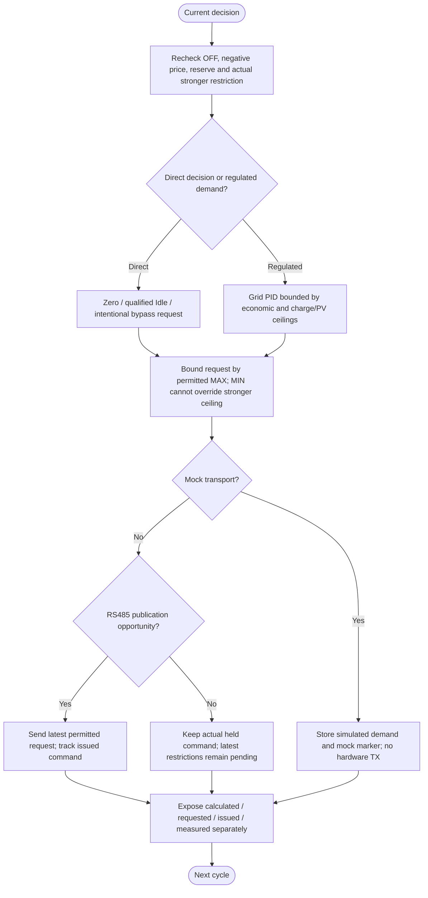

---
puppeteer:
  landscape: true
  format: A4
  printBackground: true
---

# SIL - One inverter request and truthful feedback

[Active plan](../superpowers/plans/2026-10-20-sil-sbt-ha-integration.md) / [specification](2026-10-20-integration-spec.md).

The inverter RS485/mock path is implemented. A complete automatic MOS protection coordinator is not; receiver command previews remain locked. No generic planned acknowledgement in an older diagram is proof of inverter feedback.

Existing RS485 cadence is reused. An issued request is not inverter acknowledgement or guaranteed physical zero; the actuator may retain its last setpoint if SIL fails. Both controllers must track the selected/transmitted/held command for anti-windup, not merely a nominal ceiling. Actual device timing/response remains owner plant acceptance.

Real received alarms are processed immediately under their existing policy, with no MQTT-timeout debounce. This does not promise zero transport latency. No blind MOS retry, fresh-command replay or production actuation is authorized by test acceptance.