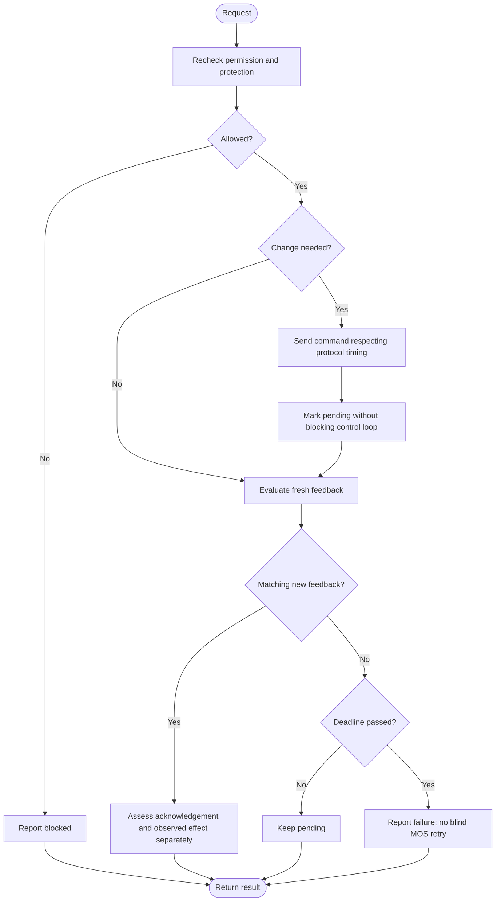

---
puppeteer:
  landscape: true
  format: "A4"
  printBackground: true
---

# SIL - Send setpoints and check observed effects

Current baseline: [Round 5 decisions and initial constants](round-5-decisions-and-defaults.md). Round 5 takes precedence over older proposals; no device settings have been changed.

Status: 2026-10-17, Round 5. Owner-approved first design; not implemented or hardware-qualified.

**Inputs and outputs:** Permitted setpoint or MOS request -> confirmed, pending, or failed state.

**Shapes:** Rectangle = action; double-sided rectangle = subprogram; diamond = decision; rounded shape = start/end.

Distinguish request, acknowledgement, and observed MOS state. A transport acknowledgement does not prove physical state. Check pending state on a proposed one-second tick, not on every cycle; do not use a blocking delay. Protection events remain urgent. Boot must read actual state and must not replay a MOS action. Retry limits and expiry need protocol qualification; do not blindly retry MOS operations. Inverter writes retain the existing RS485 Publish Period (s), currently 2 seconds per owner, with no additional 10 W change threshold. Recheck the newest request and all restrictions when a publication is due. The pending-feedback timer does not redefine the inverter publication period. MAX is a request, not guaranteed output.

Use one active target revision per actuator. Urgent protective restrictions supersede older requests; late replies must not confirm a newer target. Reuse the SBT request identity and expiry contract. Recheck the overall gate and the separate Hand/Auto ownership before transmission. A one-second nonblocking feedback tick does not delay event-driven fault handling. See [Round 5](round-5-decisions-and-defaults.md).

See the accepted [charge-target and dynamic PV-ceiling addendum](10-ladeziel-und-pv-begrenzung.md) for storage control, shared actuator arbitration, ramp exceptions, and the accepted transient-discharge limitation.
