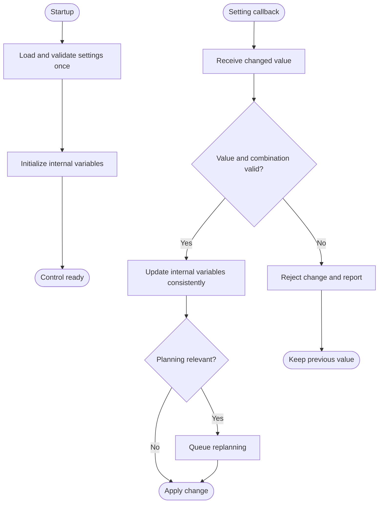

---
puppeteer:
  landscape: true
  format: "A4"
  printBackground: true
---

# SIL - Load settings once and apply callback updates

Current baseline: [Round 5 decisions and initial constants](round-5-decisions-and-defaults.md). Round 5 takes precedence over older proposals; no device settings have been changed.

Status: 2026-10-17, Round 5. Owner-approved first design; not implemented or hardware-qualified.

**Inputs and outputs:** Startup or setting change -> validated internal variables and, when needed, a planning request.

**Shapes:** Rectangle = action; double-sided rectangle = subprogram; diamond = decision; rounded shape = start/end.

Load settings once at startup. Callbacks update internal variables; the control cycle uses them without rereading NVS or JSON. Recheck permissions immediately before any write. Callbacks should remain brief and queue expensive replanning. If callbacks can run concurrently, provide a consistent handoff. On boot, read actual MOS state, do not replay MOS commands, update internal variables from callbacks, and recheck state before a write. Use the shared startup/recovery routine from Round 5: retain fault and mode ownership, qualify source data, select price policy, recalculate, then enable the bounded controller path. Never treat restart as clearing a known fault. Physical inverter behavior on total SIL failure still needs qualification.
