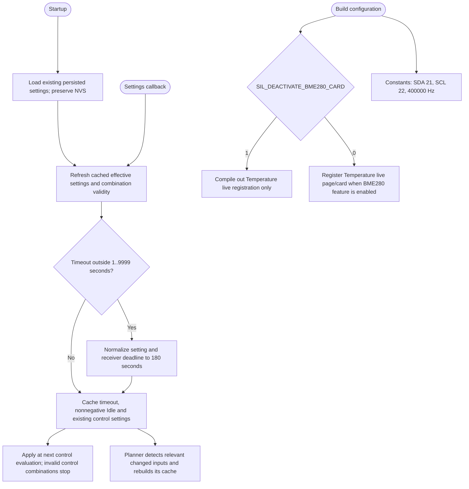

---
puppeteer:
  landscape: true
  format: A4
  printBackground: true
---

# SIL - Implemented settings and visualization boundaries

[Active plan](../superpowers/plans/2026-10-20-sil-sbt-ha-integration.md) / [specification](2026-10-20-integration-spec.md).

| Setting / switch | Implemented meaning |
| --- | --- |
| `LimiterIdleW` / Idle Output (W) | Default 500; cached as nonnegative and clamped to effective MAX at decision time. UI order is Max, Idle, Min. MIN cannot raise this fallback. |
| `sbtAgeS` / SBT Data Timeout (s) | Integer 1..9999, default 180. Invalid loaded or edited values normalize to 180. Multiplication to uint32 milliseconds is bounded. This is a grace/display deadline, not an alarm or MOS command timeout. |
| `pvTopic` / PV Forecast Topic | Default `homeassistant/sensor/solar_forecast/shed/schedule`; changing it clears the old PV snapshot and changes the subscription. |
| `fcTopic` / Price Schedule Topic | Existing independent price input. Changing it clears that schedule while preserving measured-energy history. |
| `SIL_DEACTIVATE_BME280_CARD` | Standard default 1 hides Temperature visualization; 0 restores it. Independent of the actual hardware feature switch `FEATURE_BME280_ENABLED`. |
| `SIL_QUALIFIED_MPPT_MAX_CHARGE_A` | Default 35 A for the accepted installed MPPT 150/35; multiplied by fresh charger battery voltage for planning. Zero means unknown/no forecast storage credit. No device current setting is written. |

The editable I2C configuration is removed; constants are SDA21, SCL22 and 400000 Hz. Old NVS keys remain inert and are not erased or repurposed. Optional OLED code retains its existing address configuration rather than inventing a new hardware address.

Hiding the Temperature card preserves BME280 sampling, pressure/internal consumers and existing temperature, humidity and dewpoint MQTT channels when the hardware feature is enabled. The System live card is removed; WiFi/System settings, OTA, time and required raw system providers remain. Only `UsedHeap`, `FreeHeap` and `HeapFragmentation` appear under Limiter, derived from a bounded heap tuple with a zero-free-heap guard.

BMS detail visibility is reduced without deleting the underlying receiver/control contract. `NTC 1 (Top)` and `NTC 2 (Bottom)` follow original JBD order, not minimum/maximum sorting; absent positions remain unavailable. The physical labels do not prove installed sensor placement. Callbacks cache effective settings; the fast loop does not serialize settings or write NVS on each control cycle.
