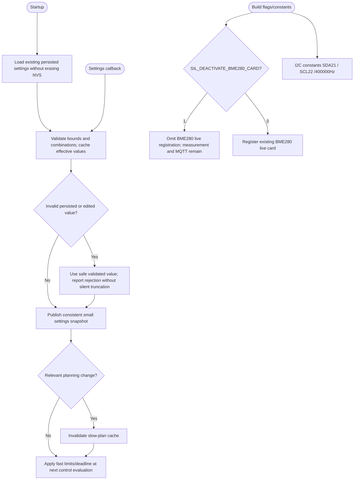

---
puppeteer:
  landscape: true
  format: A4
  printBackground: true
---

# SIL - Settings and build-time visualization

[Active plan](../superpowers/plans/2026-10-20-sil-sbt-ha-integration.md) / [specification](2026-10-20-integration-spec.md). The new settings and PIO switch are planned, not implemented by this documentation update.

Limiter order: Max Output, Idle Output default500W, Min Output. `SBT Data Timeout (s)` accepts1..9999, default180; this is not an alarm-delay setting. The same effective deadline drives Old/recovery policy without a doubled wait. Intentional Limiter-OFF bypass remains distinct from source-loss fallback.

Remove editable I2C Config objects while preserving verified wiring and leaving old NVS keys inert. `SIL_DEACTIVATE_BME280_CARD=1` is separate from actual BME280 feature enablement. Source/thermal functions and existing MQTT stay present even when the card is hidden. Settings/callbacks must not block the fast control path or rebuild JSON/NVS each cycle.