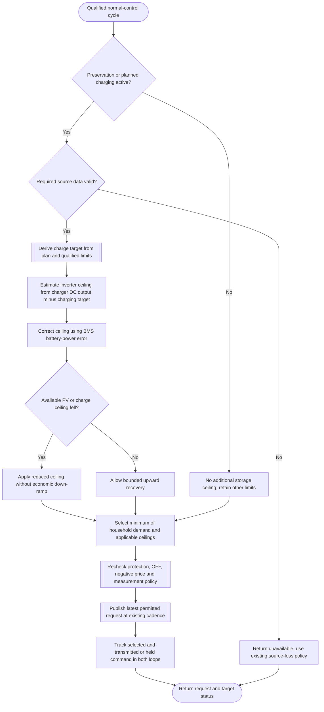

---
puppeteer:
  landscape: true
  format: "A4"
  printBackground: true
---

# SIL - Charge target and dynamic PV ceiling

Status: 2026-10-17. Owner-approved addition to the [Round 5 baseline](round-5-decisions-and-defaults.md); not implemented or hardware-qualified.

**Inputs and outputs:** Planned charging allocation, time to target window, fresh time-aligned charger DC output and signed BMS battery power -> dynamic inverter AC ceiling and charging-target status.

**Shapes:** Rectangle = action; double-sided rectangle = subprogram; diamond = decision; rounded shape = start/end.

## Planned target and measured feedback

Preservation means no intentional battery discharge. Active storage additionally requests net charging to fill the energy allocation for a later expensive window. Derive the positive DC charging target from the remaining battery-side energy shortfall and remaining target time, using the common energy ledger and qualified charge limits. If the allocation is recorded on the AC side, convert it once to the battery side. Guard expired windows and zero remaining time; replan rather than divide by zero. Do not invent a charging target from unavailable energy data.

Available PV limits what can actually be achieved. Retain and expose any target shortfall; do not claim that the planned target was reached merely because the inverter was reduced to zero. With no future plan, the existing cheap-price preference may favor charging by withholding inverter output, while comfort preservation permits qualified PV use without intentional discharge. This distinction does not create a new forecast or a fixed 400 W charging setting.

Use Victron **charger DC output**, not uncorrected panel-input power. Define BMS battery power as positive for charging and negative for discharging. A starting feed-forward estimate is:

`P_inverter_AC_ceiling = eta_inverter * max(0, P_charger_DC - P_charge_target_DC - P_other_DC_loads)`

All powers are W, and `eta_inverter` is the qualified DC-to-AC estimate. Account for inverter idle consumption and measurement placement; BMS feedback corrects remaining losses and mismatch. A small PI correction reduces the ceiling when measured net charging is below target and may increase it when charging exceeds target. Tune with actual sensor cadence and inverter response; do not specify unverified PI gains as accepted defaults.

Use the adjustable `pwrDb` to qualify direction/noise handling and derive a preservation margin without another mandatory setting. A margin is not an instantaneous no-discharge guarantee. Values inside the direction band still count in energy accounting; the classifier must not hide sustained battery energy loss.

## One actuator and explicit priorities

In qualified normal limiter operation, select the minimum of the household-demand request, the charge/PV ceiling when applicable, the price/energy ceiling, and the device/directional-protection limits. Protection arbitration may replace the normal charging target to relieve a charging fault, while respecting discharge restrictions, explicit OFF and negative-price zero. An active storage ceiling takes precedence over a positive normal MIN; otherwise MIN could deliberately drain the battery during a cloud passage. Limiter OFF and source-loss behavior retain their explicitly agreed bypass/fallback semantics.

The grid PID and charge-loop PI do not independently overwrite the inverter request. Both need conditional integration or tracking that prevents windup when another constraint wins. Account for the selected request and the command actually transmitted/held during the RS485 publication interval, using each controller's own units and sign. Reset or track inactive loops for a bumpless mode return.

A falling charge/PV ceiling bypasses the 50 W/s economic downward ramp. Recover upward in a controlled manner; a looser ceiling never forces increased inverter output. Reuse the existing RS485 Publish Period (s), currently 2 seconds per owner; do not silently introduce a faster transport schedule or extra command-change threshold.

## Illustrative cloud-passage case

Assume household demand above 1,500 W, a planned 400 W DC charging target, no other DC load, and estimated inverter efficiency 90%. These are illustrative numbers, not new fixed settings.

| Charger DC output | Feed-forward inverter AC ceiling | Charging consequence |
| --- | --- | --- |
| 1,200 W | 720 W | Approximately 400 W remains for charging before feedback correction |
| 250 W | 0 W | Available PV is below the target; report the shortfall |
| 0 W | 0 W | No PV charging is possible; target remains unmet |

The house obtains the remaining demand from the grid. The high house-load request cannot override the storage ceiling.

## Accepted physical limitation and implementation checks

The owner explicitly accepts that brief battery discharge cannot be excluded by this construction. A PV collapse can precede its measurement, the next permitted transmission and the inverter's response. The control objective is to stop unintended sustained discharge and meet the feasible charging target, not to guarantee zero battery current at every instant. Normal economics, preservation and reserve do not operate MOS; BMS hardware protections remain active independently.

During implementation, verify cloud steps, sustained low PV, no PV, target completion, mode changes, source loss, current signs, conversion losses, positive MIN arbitration, and competing controller saturation. Measure transient discharge and settling behavior at the actual telemetry and RS485 cadence. This document records design acceptance, not test results or permission for device operation.
