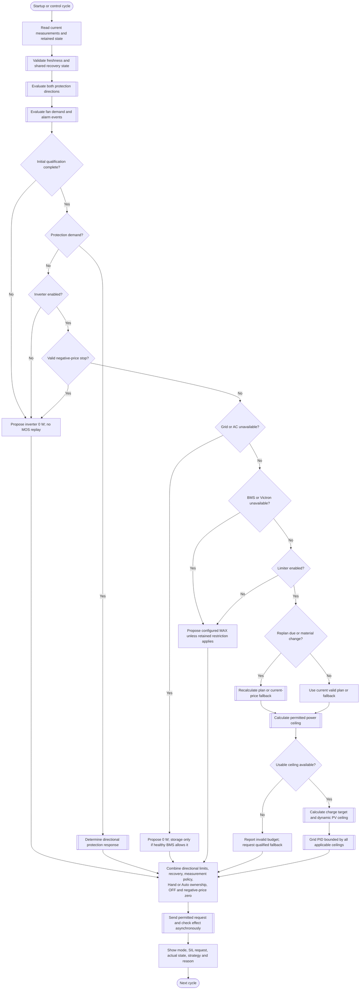

---
puppeteer:
  landscape: true
  format: "A4"
  printBackground: true
---

# SIL - Main discussion flow

Current baseline: [Round 5 decisions and initial constants](round-5-decisions-and-defaults.md). Round 5 takes precedence over older proposals; no device settings have been changed.

Status: 2026-10-17, Round 5. Owner-approved first design; not implemented or approved for device operation. This Markdown file is the source; any earlier PDF is stale and must be exported again after edits.

Settings are loaded once at startup. Callbacks update internal variables used by the control cycle; settings are not reread each cycle.

**Shapes:** Rectangle = action; double-sided rectangle = subprogram; diamond = decision; rounded shape = start/end.

The protection subprogram must still enforce inverter OFF and the valid negative-price zero request; a protection branch must not leave an earlier positive inverter request active. Fan demand is evaluated on both normal and protection paths.

Protection remains active when inverter is disabled and during the Limiter OFF economics bypass. A fan ON request and Home Assistant alarm cannot prove that charging has physically stopped. MOS automation is restricted to fault handling and remains subject to the whole-control write gate. A positive MAX or inverter setpoint is a request, not a guarantee of physical power.

## Illustrative example

At 15% SOC, 1,358 W household demand, 27 W PV, and prices of €0.39/kWh and later €0.42/kWh, a prior illustration estimated about 430 W inverter output using 6.74 kWh nominal capacity, 5% reserve, 90% discharge efficiency, and a 1.5-hour window. These are historical assumptions, not a runtime guarantee. The current reserve default is 2%; the old numerical example must not be interpreted as recalculated for that default.

## Review and export

See [Round 5 decisions](round-5-decisions-and-defaults.md) and the [README](README.md) for subprogram links and PDF export instructions. Round 5 defines the reserve default, separate mode selector, price fallback and recovery direction. Hardware-path qualification, CM behavior and total-controller-failure behavior remain verification work.

See the accepted [charge-target and dynamic PV-ceiling addendum](10-ladeziel-und-pv-begrenzung.md) for storage control, shared actuator arbitration, ramp exceptions, and the accepted transient-discharge limitation.
