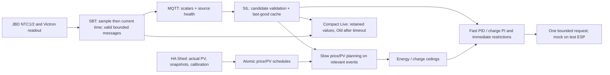

# SIL / SBT / HA integration implementation plan

> **For agentic workers:** REQUIRED SUB-SKILL: Use superpowers:subagent-driven-development or superpowers:executing-plans to implement this plan task-by-task. Steps use checkbox syntax for tracking. Respect the stop boundary and scope permissions below.

**Goal:** Stabilize MQTT telemetry and source-loss behavior, simplify SIL visualization, expose positioned BMS temperatures and integrate a correctly measured/calibrated Shed PV forecast without agent deployment to production ESPs.

**Architecture:** SBT owns acquisition and publication; SIL owns bounded last-good telemetry, slow planning and fast inverter PID/charge-PI arbitration. HA owns actual energy presentation, immutable forecast snapshots/calibration and price/PV publication. No second HA regulator and no new MOS actuation are introduced.

**Tech Stack:** ESP32 / Arduino / PlatformIO, local ConfigurationsManager >=4.7 development checkout, ArduinoJson7, PubSubClient, existing BLE/JBD/Victron adapters, Home Assistant Forecast.Solar/MQTT, Mermaid.

**Spec:** [2026-10-20 integration specification](../../control-planning/2026-10-20-integration-spec.md). Read this entire plan and spec before continuing. Both are committed repository artifacts; private chat-project reports are historical discovery only, not another active plan.

## STOP boundary and execution state

**Current session is documentation closeout only.** Write/consolidate this plan, update diagrams, remove old active plans while preserving acceptance evidence, validate documentation, commit locally on the existing work branches, report clean state and STOP. No implementation, builds, test upload or HA edit in this closeout. The owner wants to read this plan in VS Code before continuation.

All implementation checkboxes below intentionally remain unchecked. Upon explicit continuation, the recorded permissions apply without asking again. Prefer parent-led execution with one bounded SBT/publisher delegate and one independent read-only review where useful; do not spawn a fresh agent for every trivial edit. Start future implementation branches from these local checkpoint branches, not stale main. Proposed names `feature/sil-mqtt-pv-integration` and `feature/sbt-mqtt-ntc-integration`; select them only when execution actually starts, preserving the current work. No automatic main/release integration or branch deletion.

### Explicit permissions already granted

- **SIL + SBT:** coordinated product changes, focused tests/builds, two individually transmitted NTCs, configurable receiver deadline and Idle fallback.
- **Test ESP:** install SIL and SBT sequentially if one board; open Live and Settings; run at least **300 seconds per image after final stress interaction**. Identify actual target each time. SIL `SIL_MOCK_TRANSPORT=1`; no RS485 output. SBT control gate OFF and no physical MOS/charger commands. No plant data available on test SBT is an accepted limitation, not a passed data-path test.
- **Chrome:** existing logged-in HA/test tabs, scoped reads/edits and UI acceptance.
- **HA:** replace obsolete experimental forecasts by a correct **Shed** entry, migrate exact consumers, fix Energy mapping and corrected AC-power/energy helpers.
- **HA automation:** create PV forecast retrieval/snapshot/calibration/MQTT producer; adapt existing price automation as necessary. No duplicate producer or HA hardware regulator.
- **MQTT Explorer:** open authenticated session is authorized for diagnosis. Do not issue production control publishes, delete retained records or broker configuration. Test fixtures use an isolated root only. Native tooling was unavailable in the discovery harness; use a supported available tool or passive subscriber rather than claiming a capture.
- **Git now:** local documentation commits and clean working trees. No implicit push, main merge, release or cleanup of unmerged branches. Subsequent product commits follow continuation scope and repository workflow.
- **Forbidden:** production ESP upload (owner performs it), NVS/partition erasure, secrets in logs/Git, arbitrary topology/BMS-limit changes, unrelated shared-library refactors.

## Global constraints and accepted values

| Item | Required behavior |
| --- | --- |
| Alarms | Valid received alarm acts immediately; no added debounce or timeout wait. Silence does not create an alarm; known restriction is not cleared by silence |
| SBT Data Timeout | Integer seconds 1..9999, default180, candidate key `sbtAgeS`; one receiver deadline, no duplicate/doubled wait |
| Old marker | Display only `Old` after configured deadline; retain last-good numeric value. Unchanged scalar60s refresh is not acquisition age |
| Idle | `Idle Output (W)`, default500, candidate key `LimiterIdleW`, UI MAX -> Idle -> MIN; source-loss fallback bounded0..MAX, not forced up to MIN |
| Current measurement grace | Keep last approved strategy/ceiling during brief gaps without additional stale-data permission; strong stops/alarms remain immediate |
| Plans | Complete valid UTC snapshots survive publisher gaps until actual expiry/coverage end; 15min slot and36h horizon do not extend protection freshness |
| Sensor visualization | Build switch `SIL_DEACTIVATE_BME280_CARD=1` hides only the BME280 live card;0 shows it; measurement/MQTT/internal consumers remain |
| Heap visualization | System live card removed; UsedHeap/FreeHeap/HeapFragmentation moved to Limiter; zero-denominator guard |
| I2C | Constants21/22/400000Hz, preserve current active hardware; no NVS erase |
| BMS temperature | NTC 1 (Top), NTC 2 (Bottom), raw sensor order. Labels may be swapped later. Keep existing min/max MQTT for consumers |
| Forecast | Shed,1840Wp,14.8degree tilt, preserved location/south180; no900W AC clip for upstream PV offer; no invented damping |
| Meter | Corrected inverter W=max(0,rawW-2), unavailable stays unavailable; integrate separate corrected delivery kWh; actual PV uses one qualified Victron yield |
| Gates | Test both images on test ESP, Live+Settings and>=5min; no production image deployment |

Preserve the existing grid PID, price bands/reserve behavior and accepted charge PI except the explicitly scoped grace/Idle changes. SIL MOS transport remains locked. Schema additions are compatible and bounded. Check applicable version declarations before product edits; this documentation checkpoint has no version bump or changelog/release claim.

## Review focus

1. Snapshot time captured before BLE dispatch can be older than its sample; regression must cover T/T+1 and actual uint32 rollover.
2. A malformed or over-age health record must not erase unchanged scalar cache and wait60s to recover; separate acquisition status, transport grace and real alarms.
3. A long adjustable display/transport timeout must never become a MOS command-validity/protection timeout; alarms bypass grace and missing is not an alarm.
4. Old retained/previous-session data must not restart freshness, reserve permission or energy; reconnect and source restart tests are mandatory.
5. Test-board identities/partitions can differ from production and between SIL/SBT images; preflight actual target before each write and mark no-data acceptance limitations.

## Verified starting point and failure evidence

| Repository / surface | Discovery baseline |
| --- | --- |
| SIL | `feature/battery-energy-control`, e155f4374a2feb7a40f1c56a979dc5942a3823ef, production UI5.0.2 at192.168.2.122, clean before docs |
| SBT | `feature/move-sil-planning`,0928008498a18f3dbd4cd0bd0bf3949b37b581c6, production192.168.2.21, clean before docs |
| Shared CM | Adjacent local checkout; record HEAD/dirty/version at execution, no reproducible release pin implied |
| Test references | Historical COM7 /192.168.2.126 /SILTest/COM7; verify actual current port/device/IP and profile; isolated SBT root must also be verified |
| HA | `http://homeassistant.local:8123`, authenticated Chrome available; Home coordinates populated, keep private |
| Actual SIL settings | MQTT listen0ms/pub5s; I2C SDA21/SCL22/400000Hz |

The BMS health field `sample_age_ms=4294967295` was observed live with reason `ok`. SBT captures old loop time at main.cpp153, dispatches BLE at156, BmsReadout.onEvent reads a newer millis at65 and publishes a newer snapshot; main.cpp162 passes the older now to MqttService.health, whose unsigned subtraction at45 wraps -1ms. SIL's15s receiver clears all seen fields; delta scalars are non-retained and refreshed fully only every60s. This is a strong source-backed explanation for missing values, not proof of a complete CPU crash. Source values/readout and SIL reads use locks; no simple scalar tearing found. SBT currently has24 publisher fields, SIL29 receiver slots; obsolete cell-count HA values are not fresh-publish proof.

Separate unresolved crash candidates: historical HTTP operator-new failure, CM dynamic MQTT preview allocation, unguarded heap-fragmentation denominator and other extreme-value robustness. Keep panic/ELF/heap evidence; do not mark the overnight crash fixed from the timestamp correction alone.

## Diagrams and actual integration

See [main integration](../../control-planning/00-main-control-flow.md), [telemetry qualification](../../control-planning/01-measurement-validation.md), [planning](../../control-planning/05-energy-planning.md), [command path](../../control-planning/08-command-and-feedback.md) and [settings](../../control-planning/09-settings-callbacks.md). Each distinguishes current source from the target. Full future protection/MOS diagrams remain requirements, not implemented capability.

## Task 1: Repair SBT health age and source diagnostics

**Files (SBT):** `src/main.cpp`, `src/telemetry/MqttService.h`, `src/bms/BmsReadout.h`, `src/victron/VictronReadout.h`; create focused `test/host/health_age_test.cpp` and `tools/test/run-health-age-tests.ps1`. Inspect actual layout before editing; use existing host stubs rather than introducing a framework.

**Interfaces:** keep existing `updateBms(...,receivedAt,sequence,now)` / `updateVictron(...,receivedAt,now)` transport meaning. Copy snapshot before capturing its `now`; a pure helper may expose `sampleAgeMs(uint32_t now,uint32_t receivedAt)` for modulo arithmetic, but test must exercise production ordering, not just subtract two constants.

- [ ] Capture governance, branch, CM dependency and existing ELF/hash evidence before code edits. Record baseline, not secrets.
- [ ] Write failing regression `new_sample_after_loop_timestamp_is_not_old`: old loop T, BLE event/sample T+1, health generated after snapshot atT+2 ->age1, notUINT32_MAX. Add unavailable, true expiry and rollover e.g received0xfffffff0/current0x10 ->32ms cases.
- [ ] Run focused host test and confirm the known failing ordering is represented.
- [ ] Fix post-snapshot timestamp use for BOTH source paths; preserve unavailable semantics, sequence advancement and source reasons. No arbitrary clamp-to-zero of truly stale data.
- [ ] Verify host test passes; update MQTT health contract explanation and source/consumer timeout distinction.
- [ ] Record exact changed paths and product version impact; do not call overnight crashes fixed.

## Task 2: SIL bounded cache, 180-second default and Idle fallback

**Files (SIL):** `src/sbt/SbtReceiver.h`, `src/sbt/SbtService.h`, `src/control/PreparedControl.h`, `src/control/CurrentControl.h`, `src/main.cpp`; extend `test/host/sbt_receiver_test.cpp`, create `test/host/current_control_test.cpp` and a focused host runner in `tools/test/`.

**Interfaces:** add receiver timeout configuration in milliseconds (validated1..9999s at settings boundary); preserve `valid/numeric/sourceHealth` callers but distinguish retained value from usable/control status. Add candidate `PreparedSettings::idleOutputW=500`; use it in the existing normal source_loss branch after the configured grace. Keep `CurrentDecision` reason explicit for held/expired states and publish Old metadata for UI.

- [ ] Write failing cache test: valid values ->malformed numeric/health ->good advancing health but unchanged scalar; retain old value, no timestamp rejuvenation and no false zero/MAX. Explicit unsupported/null remains distinguishable.
- [ ] Write deadline tests at1/180/9999s, last-valid before/at/after boundary, unchanged scalar60s but healthy advancing5s source heartbeat, missing heartbeat, stale upstream reason, reconnect/root/session change and retained replay.
- [ ] Write immediate-alarm test: valid alarm at any time inside grace ->existing restriction now, no extra deadline. Missing message ->no synthesized alarm; known restriction persists.
- [ ] Write Idle tests: default500,0,aboveMAX,belowMIN; BMS-only/Victron-only/both loss; blocked reserve0; OFF/negative-price/grid loss stronger; intentional Limiter-OFF unchanged; healthy PID unchanged.
- [ ] Implement candidate-then-commit parsing; preserve cached values on transient malformed input and local reconnect for display, fence unknown/restarted sources from healthy permission until qualified. Use existing root/control-session evidence where suitable; if old protocol cannot prove session continuity, keep previous values display-only until new valid sample/qualification, not pretend certainty.
- [ ] Reconcile producer30s availability as source diagnostic with the consumer-configured deadline; no cache erase merely on stale reason, no relaxation of SBT MOS readiness or physical protection clocks. Keep actual alarm data on its immediate path.
- [ ] Add settings `sbtAgeS` (1..9999/default180) and `LimiterIdleW` (default500), unique key search, cache safe values after load/callback, exact UI MAX/Idle/MIN order. Preserve existing stored MAX/MIN.
- [ ] Apply Old only on expired valid-source evidence, not time since scalar delta publication. On startup absent data stays unavailable. Within grace no additional stale-data freedom; expiry selects bounded Idle unless stronger stop.
- [ ] Run changed receiver/control host suites; inspect source/control state transitions and existing publisher contract suite for compatibility.

## Task 3: Expose positioned NTC channels end-to-end

**Files (SBT):** `src/bms/JbdProtocol.h`, `src/telemetry/TelemetryChannels.h`, `docs/MQTT.md`, relevant JBD/publisher tests. **Files (SIL):** `src/sbt/SbtReceiver.h`, `src/sbt/SbtRuntimeMetadata.h`, receiver/publisher-contract tests.

**Interfaces:** compatible scalar topics `bms/temperature_1_c` and `bms/temperature_2_c` in C, original JBD protocol order, labels NTC 1 (Top)/NTC 2 (Bottom). Existing min/max unchanged. No new BLE query or actuator.

- [ ] Write failing two-NTC test with first17.5C/second21.5C, then reverse temperatures; identities must not swap with max/min. Cover zero/one sensor, invalid sensor and stale source without fake substitutions.
- [ ] Publish/cache two independently validated values from existing frame data, preserve min/max computations and existing consumers. Verify26 SBT descriptors /31 SIL receiver slots and32-bit mask safety, all tables/static assertions/indexed text channels.
- [ ] Add SIL receiver/metadata labels and both channel contracts; retain alarm/protection fields.
- [ ] Run focused JBD, publisher and SIL sibling-contract tests; capture expected channel counts, do not require physical sensor positioning to be final.

## Task 4: Reduce SIL visualization with reversible BME280-card flag

**Files:** SIL `src/main.cpp`, `src/sbt/SbtRuntimeMetadata.h`, `src/runtime/CompactLiveMetadata.h` if necessary, `platformio.ini`, `readme.md`, `test/host/compact_runtime_metadata_test.cpp`. Shared CM only if a minimal supported registration/filter API is needed; inspect its governance and do not rewrite the library.

**Interfaces:** `SIL_DEACTIVATE_BME280_CARD` 1 hides/0 shows, default1 in standard profiles; separate from FEATURE_BME280_ENABLED. Only three heap values placed in Limiter. I2C constants21/22/400000Hz; old keys remain unused in NVS, never erased.

- [ ] Pin expected visible field inventory in focused metadata tests. Assert the requested BMS details/unsupported MPPT fields are absent, both NTCs and required SoC/power/status remain, raw receiver/control data still accessible.
- [ ] Keep Temperature page code under compile-time visualization flag; remove registration only when1. Verify no temperature MQTT topic or internal BME consumer is removed.
- [ ] Remove System live card registration, retain independently used System/WiFi settings/providers; register UsedHeap/FreeHeap/HeapFragmentation compactly under Limiter. Test freeHeap0 without division crash and a consistent snapshot tuple.
- [ ] Replace I2C Config settings with verified constants and remove exclusive settings metadata; optional OLED address remains correctly scoped to that feature.
- [ ] Run metadata test in both card flag variants; build main acceptance profile plus smallest alternate compile needed to prove the0 branch. No redundant full repository test run.
- [ ] Compare equivalent flash/staticRAM/runtimeheap and largestblock before/after; report measured costs or savings, not promised improvements.

## Task 5: HA Shed configuration and corrected energy sources

**Artifacts:** create reviewed `docs/home-assistant/shed-migration.md` and `docs/home-assistant/shed-energy.yaml` in SIL (actual intended configuration/export, no secrets). Read live state before assuming old IDs still exist.

- [ ] Inventory all six old Forecast.Solar entries, exact IDs/settings and consumer references; privately export rollback. Recover existing Home coordinates via UI without copying them to Git.
- [ ] Create **Shed** with1840Wp /14.8degree /qualified south180 /saved location, damping0/0 and no900W AC clip. Verify actual provider response and new entity IDs. Migrate consumers and select only Shed in Energy.
- [ ] Delete exact obsolete forecast entries only after replacement works and references are migrated; do not delete recorder history or unrelated integrations. The owner expressly authorized replacement, not merely disabling one arbitrary entry.
- [ ] Reconcile Victron daily-yield reset observed near16:30; inspect actual reset-aware statistic sum/deltas and source/device cause. Keep the day excluded from calibration until reconciled. If unavailable evidence blocks exact accounting, record that narrow blocker rather than invent a total.
- [ ] Inspect existing solar_self_consumption_power template and Energy mappings. Implement corrected inverter W=max(0,raw-2) with unavailable propagation and a separate corrected kWh delivery counter; test0/1/2/10/682W ->0/0/0/8/680W. Do not overwrite raw cumulative history or integrate across outages.
- [ ] Use exactly one qualified Victron yield statistic as PV generation; retain battery charge/discharge separately and inverterAC as delivery, no double counting. Clearly document DC/AC losses/approximation.
- [ ] Verify sunrise battery charging is represented as solar generation before inverterAC starts; verify nighttime2W no longer counts as generation. If only historical/live snapshots are possible, distinguish configured behavior from next-night acceptance.

## Task 6: HA forecast/price producer and bounded SIL PV planning

**Artifacts/code:** create `docs/home-assistant/shed-forecast-package.yaml`, `docs/control-planning/mqtt-schedule-contract.md`, SIL `src/control/PvForecast.h` and `test/host/pv_forecast_test.cpp`; modify `FuturePrices.h`, `CurrentControl.h`, `main.cpp` only at existing interfaces. Update installed price automation and example `docs/control-planning/ha-price-schedule.yaml` consistently.

**Interfaces:** independent pricev1 and PVv2 revisions. PV topic candidate `homeassistant/sensor/solar_forecast/shed/schedule`; UTC900s, <=144slots/36h,24/chunk,768-byte target, explicit generation/expiry/source/scale/quality/factor. `PvForecast` exposes receive/active snapshot only; planner consumes bounded offered/usable energy, never writes an actuator.

- [ ] Discover full provider forecast-series action/response supported by installed HA; daily `_today` is not a series. Verify free-tier native resolution/update cadence. Normalize hourly energy conservatively with Wh conservation and explicit disaggregated quality; missing stays missing.
- [ ] Save immutable pre-period forecasts; implement daily qualification with valid matched Victron energy and reset/curtailment/outage exclusion. Candidate14eligible days/30lookback/min0.5kWh/bounds0.5..1.2; neutral1.0+uncalibrated until qualified. Publish raw factor/count/age/quality; no future-data leakage.
- [ ] Inspect EPEX future data provenance; far-future estimates must not be marked confirmed. Adapt price automation if necessary; one shared source topic, independent test/prod consumers, no accidental duplicate producer.
- [ ] Capture actual example JSON, delimiter text and binary wire sizes/CPU/peakheap/largestblock/staticRAM. Default to bounded JSON extension; binary only if measurements justify fully specified signed/scaled/little-endian/CRC/chunk design.
- [ ] Write failing PV receiver tests: malformed/range/oversize, shuffled/missing/conflicting/duplicate chunks, session/revision rollback, expiry, startup/no-clock, DST and retained replay. Active plan changes only after full validation.
- [ ] Implement fixed active/pending storage and bounded parser. Budget784bytes PV state plus scratch; explicitly account extra4096 if safe existing-arena reuse cannot be proven. Keep price limits and MQTT buffer unchanged unless evidence requires reviewed change.
- [ ] Write economic trace tests: cheap midday/expensive evening, low sun, fullbattery/curtailment, cloudstep, reserve, OFF/negativeprice, insufficientforecast and missingprice. Compare offered PV vs actually usable storage separately; no forced export, no duplicated energy pool/losses.
- [ ] Cache expensive planning; trigger on accepted snapshots, UTC slot boundary, relevant settings/qualification/materialevents and existing30min replan maximum. Keep signed energy debit/current-slot remaining time and fast restrictions current every cycle. Define material thresholds from observed noise/cadence, not arbitrary undocumented percentage.
- [ ] Deploy the approved HA package/price changes through the existing authenticated UI/configuration mechanism, verify saved syntax/run traces/topics and no actuator side effects. Keep original snapshots and explicit neutral calibration while collecting enough eligible days.

## Task 7: Required focused build and test-ESP acceptance

**Evidence:** create `docs/acceptance/2026-10-20-integration-acceptance.md` when execution occurs. Store verbose logs/ELF locally ignored; commit concise nonsecret results only.

- [ ] Run existing affected scripts: SBT JBD/MQTT/health tests, SIL `tools/test/run-sbt-receiver-tests.ps1 -SbtRepository ../SolarBatteryTelemetry`, compact metadata tests and new focused controller/PV suites. Locate actual existing script names before invocation; use task-specific runners named above for new tests.
- [ ] Build each relevant PlatformIO profile with exact local CM identity recorded. Normal defaults: `pio run -e usb`; SIL historical test config `.pio/compact-runtime-metadata/platformio-test.ini` must be revalidated, not blindly reused. Record BIN/ELF SHA256, flags, versions, flash/staticRAM and used/largest heap.
- [ ] Verify physical test ESP port/chip/current partition table/appslot and MQTT isolation before EACH upload. Production IPs192.168.2.122/.21 are excluded. If one board, record image swap and reconnect identity; application-only write, no NVS/partition erase.
- [ ] Install SIL mock image; verify no RS485 init/send/receive or MOS writes, existing real input subscriptions may be used but test publications isolated. Open Live and every affected Settings page, reload/navigate several times, watch HTTP completeness/heap/uptime.
- [ ] Observe at least300 continuous seconds AFTER the last stressful UI action. Record start/end/timezone, stable uptime, resetreason, min/free/largestheap and no panic/reboot/hang. Repeat on failure after targeted correction.
- [ ] Install SBT on test ESP with distinct identity/root and all actuator writes disabled. No real BMS/Victron data is expected. Verify all Live/Settings pages safely show unavailable, no crash on missing data, no unwanted peer/control operation.
- [ ] Observe SBT for at least300 continuous seconds after final UI stress; record the same metrics and no-data limitation. Retain host synthetic-fixture evidence separately, never call it physical BLE acceptance.
- [ ] On either panic/hang/partial response, preserve matching ELF and full trace, stop progression and investigate. Five minutes without failure is smoke evidence, not proof of overnight stability.
- [ ] Prepare owner deployment handoff with matched artifacts, required settings/migration, no-data limitations, rollback image and unresolved real-plant checks. **Do not upload production.**

## Task 8: Documentation, integration handoff and final stop

- [ ] Update actual behavior docs/Mermaid and MQTT/HA contracts to the implemented state; retain clear limitations of full fault/MOS coordinator and controller-failure actuator behavior.
- [ ] Review only affected diffs and focused evidence; apply version/changelog policy for actual product changes. Verify no secrets, local override state, .pio/tool DBs or private coordinates are staged.
- [ ] Record both repository branches/HEADs/dependency identity, relevant validations, test-ESP image identities, HA changes and remaining plant acceptance. Preserve separate commits per meaningful repository slice.
- [ ] Only perform Git integration/publication explicitly requested at that time; no automatic main merge/release/push or unmerged branch cleanup.
- [ ] Stop and hand over to owner for production deployment.

## Historical-plan consolidation and current checkpoint ledger

The old implementation plans are removed from planning directories; mixed documents with real test/build/upload results are preserved under `docs/acceptance/*-evidence.md`. Round4 discussion/review is superseded by Round5 and this specification; its Git history remains available. Accepted Round5 design and source-specific acceptance documents remain references, not competing active task lists. `implementation-follow-ups.md` is a historical implementation/evidence ledger; this plan is the sole current work queue.

At this documentation checkpoint: no firmware/configuration/HA automation was changed, no build/upload/monitor/plant command was run. Markdown/link/reference/Mermaid checks and local documentation commits are the only completion checks. Future execution must not tick acceptance from historical evidence. The local commit hashes can be read from each branch after this checkpoint; do not embed the hash of the commit being written inside itself.
### Planning-closeout verification (not product acceptance)

Completed during this documentation session: independent read-only scope/source review; local links and code fences checked across28 changed/new Markdown files in both repositories; all13 Mermaid blocks in the plan/reference folder parsed and rendered with the already installed VS Code Mermaid bundle in isolated local headless Chrome, no network access; `git diff --check` passed in both repositories. Historical acceptance content was preserved during relocation. No firmware tests/builds, serial monitor, test upload, HA edits or production action occurred. Firmware version/changelog changes are unnecessary for this documentation-only checkpoint.
